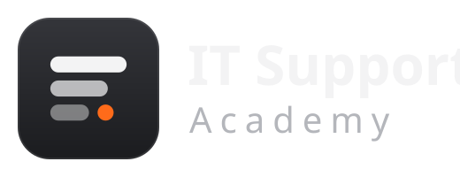
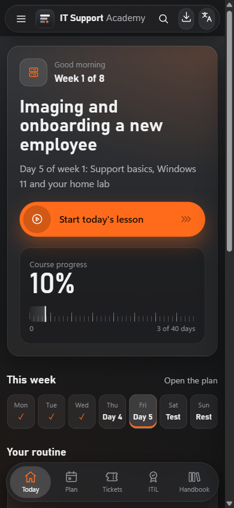
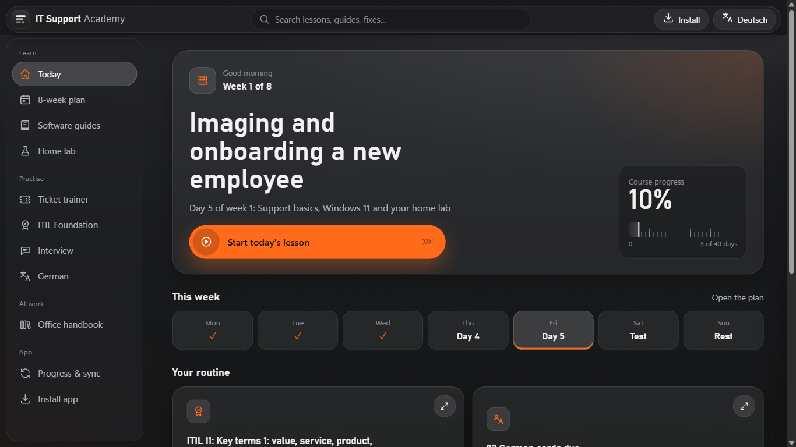

# IT Support Academy

**Live app:** https://asifiu.github.io/it-support-academy/ · **Design on every screen:** https://asifiu.github.io/it-support-academy/docs/showcase.html

 

An 8-week, hands-on plan to get job-ready for **IT Support / Service Desk / Junior System Administrator** roles in Germany, with an **ITIL Foundation** course and a **workplace German** side panel. It is a small web app that works on a PC and on a phone, also offline.

## Why these topics

The plan comes from 55 real IT support and sysadmin job ads in Germany (Oct to Nov 2026). Number of ads that asked for each skill:

| Skill | Ads | Where in the plan |
|---|---|---|
| Hardware, client setup, imaging | 36 | Week 1 |
| Ticket system / ticket handling | 35 | Week 7 + Ticket trainer |
| Networking (TCP/IP) | 32 | Week 2 |
| Documentation | 28 | Every lab, Week 7 |
| Microsoft 365 | 27 | Week 4 |
| Active Directory | 24 | Week 3 |
| VLAN / switching | 23 | Week 2 |
| Security | 20 | Week 6 |
| Firewall | 19 | Weeks 2 and 6 |
| ITIL | 16 | ITIL course, Week 7 |
| Intune / MDM | 14 | Week 4 |
| German C1 / fluent | 11 | German panel |
| Windows Server | 10 | Week 3 |
| Scripting (PowerShell, Bash) | 10 | Week 5 |
| Linux | 8 | Week 5 |

## The 8 weeks

| Week | Topic |
|---|---|
| 1 | Support basics, Windows 11, building the Hyper-V home lab |
| 2 | Networking: OSI, subnetting, DNS, DHCP, VLANs, troubleshooting |
| 3 | Windows Server, Active Directory, Group Policy, file shares, printers |
| 4 | Microsoft 365, Entra ID, Exchange Online, Teams/OneDrive, Intune |
| 5 | PowerShell, Linux, Bash, automation |
| 6 | Security, patching, BitLocker, LAPS, backup, virtualisation, OPNsense firewall |
| 7 | Service desk in practice: real ticket tool, incident/problem/change, KB |
| 8 | Portfolio, interview drill (EN + DE), ITIL mock, applications |

**Daily rhythm (about 4 hours):** 1 h learn, 2 h lab, 30 min ITIL, 30 min German. Saturday: weekly test + write up the lab on GitHub. Sunday: rest.

## What is in the app

**Design ("graphite glass"):** a dark graphite room with frosted-glass tiles and one signal orange for actions, like the activity light on a server. Every "I did this" tick is an orange switch, progress is shown as ruler gauges, the main action is a wide orange pill, and headings use Bahnschrift (DIN style, built into Windows). Side navigation on PC, a floating bottom bar on phones, and a search box at the top (press `/`).

- **Today**: what to do today, based on your start date.
- **8-week plan**: every day has a detailed **Teach me** lesson (plain language, examples, every command explained), key points, a hands-on lab, self-check questions, free links, and a notes box.
- **Home lab**: the VMs you build (DC01, CLIENT01, LNX01, OPNsense...) and the IP plan.
- **Software guides**: 11 guides (Microsoft 365, Active Directory, Windows Server, Entra ID, Intune, Exchange/Outlook, Teams/SharePoint/OneDrive, Hyper-V, PowerShell, ticket systems, Linux). Each one in 3 parts: **1. Big picture** (what it is, why companies use it, its parts, where you meet it at work), **2. Go deeper**, **3. Practice** (hands-on lab with "done when" checks). The day that uses a tool links to its guide first.
- **Diagrams**: 15 drawn diagrams (home lab network, Microsoft 365 map, AD structure, Kerberos logon, DNS order, email path, file locations, Intune + Conditional Access, Hyper-V, ticket lifecycle, printing, permissions, GPO order, support levels, troubleshooting loop) inside the lessons, guides and deep dives.
- **Install button**: on Android/PC it installs directly; on iPhone it shows the Safari steps.
- **Career tracks**: IT Support, System Administrator and Network Engineer. 14 courses, 43 modules, 132 quiz questions, each module marked Foundation, Professional or Senior: Microsoft 365, Exchange Online, SharePoint/OneDrive/Teams, Entra ID, Intune, Active Directory (incl. tier model and attack paths), Windows deployment and imaging (Autopilot, ConfigMgr OSD, DISM; MDT retired), cloud (Azure, AWS), and networking mapped to the six CCNA 200-301 domains, plus senior network design.
- **Cisco CLI simulator**: switch and router with IOS modes, abbreviations, Tab completion, ? help, show commands and four guided labs checked live (first setup, VLANs and trunk, router interfaces and static route, SSH).
- **Subnetting trainer**: random IPv4 questions with explanations and a streak counter.
- **KI tutor (top bar and "Ask KI" in every lesson)**: IT tutor that knows the page you are on, and a German conversation partner at your level (A1 to B2) that asks questions, insists on full sentences and corrects every mistake. Voice input and spoken answers. Uses your own Anthropic API key, stored only on your device.
- **Wortschatz**: 2000 German words in 33 topics (everyday life, office, IT, authorities, B1 discussion words), each with English, Bengali and an example sentence. Shuffle cards in three modes (German to meaning, meaning to German, choose the right one) with a "Beispiel" button, a searchable and filterable word list with audio and "Play all", New/Learning/Known status, and a daily Tagesziel: 20 new words, a test (8 of 10 to pass), then 3 own sentences that must use today's words. The Tagesziel stays on the Today page until it is done. Data: `data/wortschatz-*.js`, logic: `js/wortschatz.js`.
- **German course**: A2.1 and B1.1 (14 lessons) following the Schritte plus neu lesson order and grammar topics, with new explanations, vocabulary with audio, a vocabulary quiz, gap and word-order exercises, and "Sätze bauen" (you must write your own sentences; the KI checks them). Lesson words go into the flashcards. More levels are added by the daily job (see docs/BACKLOG.md).
- **Azure administration** (AZ-104 areas) and **Linux administration** (LPIC-1 / Linux+ / LFCS level, with a senior hardening and containers module).
- **Daily improvement**: a scheduled job builds the next item in docs/BACKLOG.md each evening, checks facts, tests and publishes.
- **Journey maps**: each career track is a road with stages, stations (courses), certification checkpoints and the destination job. XP for everything you finish, ranks from Ping to Infrastructure Legend, a daily streak and badges.
- **Deutsch Arcade**: Der-Die-Das Blitz, Memory, Hör-Diktat, Verb-Rennen (Präsens, Präteritum, Perfekt with haben/sein) and Satz-Baumeister. Every point is XP.
- **Interface in English or German** (switch in the side menu or Progress & sync). Course content is being translated step by step.
- **Casebooks**: real production incidents worked like a senior engineer (Active Directory, network troubleshooting).
- **Locked down**: a Content Security Policy allows scripts only from the app itself and network calls only to the app and api.anthropic.com; the Anthropic SDK is a pinned copy in `js/vendor/` (no third-party CDN).
- **Fast**: opens instantly from the offline copy and updates itself in the background; pages render in under 40 ms.
- **Store-ready manifest** (shortcuts, screenshots, categories). See docs/STORE.md for publishing to Google Play, Microsoft Store, App Store and desktop.
- **Lesson player**: every day, guide, deep dive and ITIL lesson is split into short steps with a progress bar, "Step 3 of 12", a list to jump between steps, and Back / Next until the end (swipe on phones, arrow keys on PC). It remembers where you stopped. Each day ends with a "Day complete" check.
- **Animation**: steps slide in, Today counts up its numbers and fills its gauge, diagrams draw themselves, switches and correct answers give a small confirmation, wrong answers shake, German cards flip. All of it turns off when the phone is set to reduce motion.
- **Office handbook**: use it at your desk during real work. 27 runbooks for the most common office tickets (accounts, Outlook/M365, network, VPN, printers, docks, slow PCs, blue screens, updates, phishing, lost laptops, onboarding, meeting rooms). Each one: what the user sees, why it happens, 1st level steps, 2nd level steps, commands to copy, a ticket note template, a German sentence for the user, and how to prevent it. Plus 9 "How it really works" deep dives (domain logon and Kerberos, DNS resolution, Group Policy, email and Outlook, Microsoft 365 sign-in and MFA, printing, permissions, Windows boot and updates, a real day on the service desk). Searchable.
- **Ticket trainer**: 12 realistic tickets (some in German). Choose type, impact, urgency and the best first action; get feedback.
- **ITIL**: 8 lessons (one per week) with quizzes and a 40-question, 60-minute mock exam.
- **Interview**: 32 technical and behaviour questions with answer hints.
- **German (DE button, on every page)**: flashcards with spaced repetition and pronunciation (phone support, instructions, tickets/email, IT words, job grammar, interview), plus role-play dialogs.
- **Progress & sync**: progress is stored in your browser. Export a file on one device and import it on another.

## Use it

- **On this PC**: open `index.html`, or run `python -m http.server 8765` in this folder and open http://localhost:8765 (needed for offline/install).
- **On the phone**: the app needs to be online at one address (for example GitHub Pages). Then open it in Chrome (Android: menu > Install app) or Safari (iPhone: Share > Add to Home Screen).

## Change the content

All learning content is plain data in `data/`:

| File | Content |
|---|---|
| `data/plan.js` | 8 weeks, 5 days each, weekly quizzes, home lab table |
| `data/lessons.js` | Detailed "Teach me" lessons, key `"week-day"` |
| `data/itil.js` | ITIL lessons and quiz questions |
| `data/german.js` | German decks and dialogs |
| `data/tickets.js` | Ticket trainer scenarios |
| `data/interview.js` | Interview questions |
| `data/runbooks.js` | Office handbook runbooks |
| `data/deepdives.js` | "How it really works" deep dives |
| `data/guides.js` | Software guides (big picture, deep, practice) and which day uses which guide |
| `data/diagrams.js` | All diagrams (inline SVG) |

After a change, raise `VERSION` in `sw.js` so installed phones load the new content.

## Your coding task

`js/priority.js` holds `calcPriority(impact, urgency)`, the ITIL priority matrix the Ticket trainer uses. It is yours to write (5 to 10 lines).

## Notes

- Lessons for weeks 2 to 8 are added week by week as the course goes on.
- ITIL exam facts were checked from secondary sources in Nov 2026. Read the official PeopleCert syllabus before booking.
- All tools and resources in the plan are free (evaluation ISOs, free tiers, open source).
